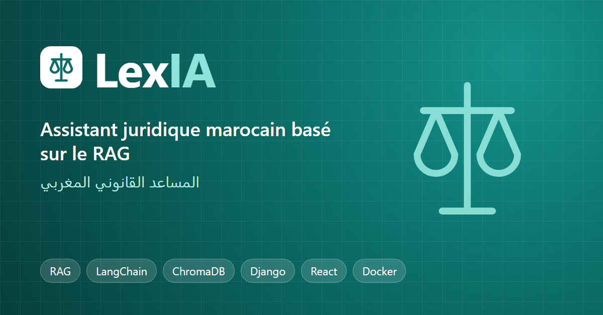

# LexIA — Assistant juridique marocain (RAG)



Projet individuel réalisé par **Mohamed Aouijil**.

LexIA est un assistant qui répond aux questions sur le droit marocain en s'appuyant sur
les textes de loi officiels (RAG : *Retrieval-Augmented Generation*). Le plan complet
du projet est dans [docs/LexIA_Plan_Projet_v1.1.pdf](docs/LexIA_Plan_Projet_v1.1.pdf).

## Structure du dépôt

```
.
├── backend/             # API Django 5 + DRF, pipeline RAG (ChromaDB + Gemini) — voir backend/README.md
├── frontend/            # Interface React 18 + TypeScript + Tailwind — voir frontend/README.md
├── data/                # Corpus juridique : 247 lois marocaines en texte (data/PDF_text)
├── docs/                # Plan du projet, conception (architecture, ERD, API)
├── legacy/              # Ancienne interface Next.js du projet de départ (référence)
├── scripts/             # smoke_test.sh : vérification d'un déploiement
└── docker-compose.yml   # Déploiement : PostgreSQL + backend (gunicorn) + frontend (nginx)
```

## Déploiement (Docker)

```bash
cp .env.example .env      # remplir DJANGO_SECRET_KEY, POSTGRES_PASSWORD, GEMINI_API_KEY
docker compose up -d --build
```

Application sur http://localhost:8080 — guide complet : [docs/deploiement.md](docs/deploiement.md).

## Démarrage rapide (développement)

**1. Backend** (premier terminal) :

```powershell
cd backend
py -3.12 -m venv .venv; .venv\Scriptsctivate
pip install torch --index-url https://download.pytorch.org/whl/cpu
pip install -r requirements.txt
copy .env.example .env            # remplir DJANGO_SECRET_KEY et GEMINI_API_KEY
python manage.py migrate
python manage.py import_laws      # 211 lois, 12 810 articles
python manage.py index_articles   # embeddings (long la première fois)
python manage.py runserver
```

**2. Frontend** (second terminal) :

```powershell
cd frontend
npm install
npm run dev
```

Puis ouvrir http://localhost:5173. Documentation de l'API : http://localhost:8000/api/docs/.
Conception : [docs/conception.md](docs/conception.md).

### data/
- `PDF_text/` : textes de loi en arabe, extraits des PDF publiés par le CSPJ
  (https://cspj.ma/bibliotheque/legislations).
- `PDFs/` (non versionné) : PDF bruts, re-téléchargeables avec `backend/ingestion/download_data.py`.

## Avancement (plan v1.1)

- ✅ S1 Conception — architecture, ERD, API ([docs/conception.md](docs/conception.md))
- ✅ S2-S3 Backend Django + DRF, auth JWT, admin, Docker Compose, CI GitHub Actions
- ✅ S4 Pipeline RAG (embeddings locaux + ChromaDB + Gemini), réponses en streaming
- ✅ Frontend React : connexion, chat, sources, feedback, interface FR / AR (RTL)
- ✅ S5 Classement automatique des questions en 17 domaines juridiques
- ✅ S6 Dashboard administrateur : statistiques, avis, exports CSV, gestion des utilisateurs, catégories et FAQ
- ✅ S7 Audit de sécurité, tests de sécurité et de charge — [docs/securite.md](docs/securite.md)
- ✅ S8 Déploiement Docker (PostgreSQL + gunicorn + nginx), vérifié en CI — [docs/deploiement.md](docs/deploiement.md)
- ⏳ Rapport final et slides

## Crédits
Le code de départ est basé sur le projet open source
[Moroccan-AI-Law-Assistant](https://github.com/ayoubdya/Moroccan-AI-Law-Assistant) (licence MIT).
