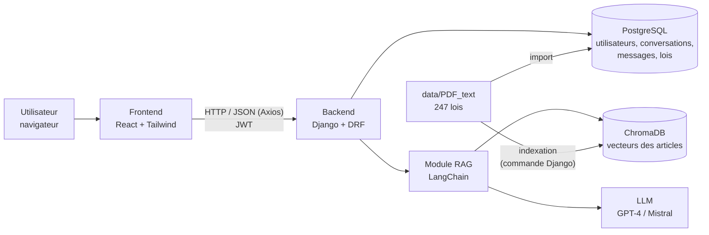
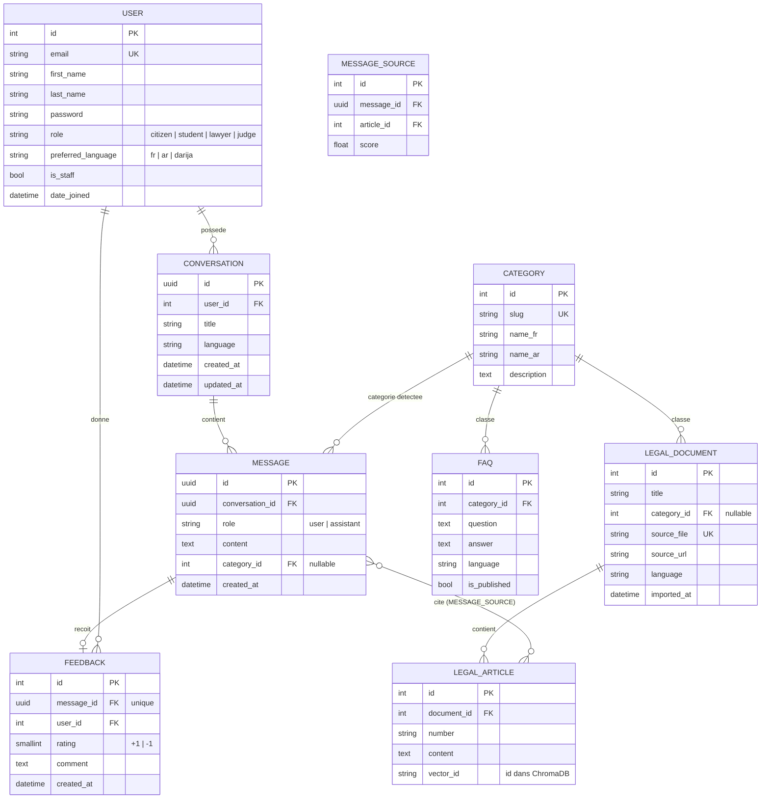

# LexIA — Conception (Sprint 1)

Auteur : Mohamed Aouijil

## 1. Architecture technique

| Couche | Technologie | Dossier |
|---|---|---|
| Interface | React 18 + TypeScript + Tailwind + Axios | `frontend/` |
| API | Django 5 + Django REST Framework + SimpleJWT | `backend/` |
| Base relationnelle | PostgreSQL | service Docker / local |
| Recherche sémantique | ChromaDB + embeddings | `backend/rag/` |
| Génération | LangChain + LLM | `backend/rag/` |
| Corpus | Textes de loi (arabe) | `data/` |

### Flux d'une question

1. L'utilisateur envoie une question (FR, AR ou Darija) à `POST /api/chat/`.
2. Django vérifie le JWT et enregistre le message.
3. Le module RAG transforme la question en vecteur et cherche les articles les plus proches dans ChromaDB.
4. Les articles trouvés + l'historique de la conversation sont envoyés au LLM avec le prompt système.
5. La réponse (avec les articles cités et l'avertissement légal) est enregistrée puis renvoyée au frontend.

## 2. Schéma de la base de données (ERD)

### Choix de conception

- **Email comme identifiant** de connexion (pas de nom d'utilisateur).
- **UUID** pour les conversations et messages : ils apparaissent dans les URL de l'API, donc on évite les identifiants devinables.
- **LEGAL_ARTICLE en PostgreSQL** en plus de ChromaDB : on garde le texte exact de chaque article cité, consultable dans l'admin, et le lien `vector_id` assure la traçabilité entre la réponse et la loi.
- **MESSAGE_SOURCE** : table de liaison qui enregistre quels articles ont servi à chaque réponse et avec quel score de similarité (utile pour vérifier l'absence d'hallucination, critère CR3).
- **FEEDBACK** : un seul avis par réponse (`message_id` unique).

## 3. Endpoints de l'API (prévisionnel)

| Méthode | URL | Rôle |
|---|---|---|
| POST | `/api/auth/register/` | Inscription |
| POST | `/api/auth/login/` | Connexion → jetons JWT (access + refresh) |
| POST | `/api/auth/refresh/` | Renouveler le jeton d'accès |
| GET | `/api/auth/me/` | Profil de l'utilisateur connecté |
| GET / POST | `/api/conversations/` | Lister / créer ses conversations |
| GET / PATCH / DELETE | `/api/conversations/{id}/` | Détail (avec messages), renommer, supprimer |
| POST | `/api/chat/` | Envoyer une question, recevoir la réponse RAG (Sprint 4) |
| POST | `/api/messages/{id}/feedback/` | Noter une réponse (Sprint 6) |
| GET | `/api/categories/` | Liste des catégories juridiques |
| GET | `/api/faqs/` | Questions fréquentes publiées |
| GET | `/api/docs/` | Documentation Swagger |
