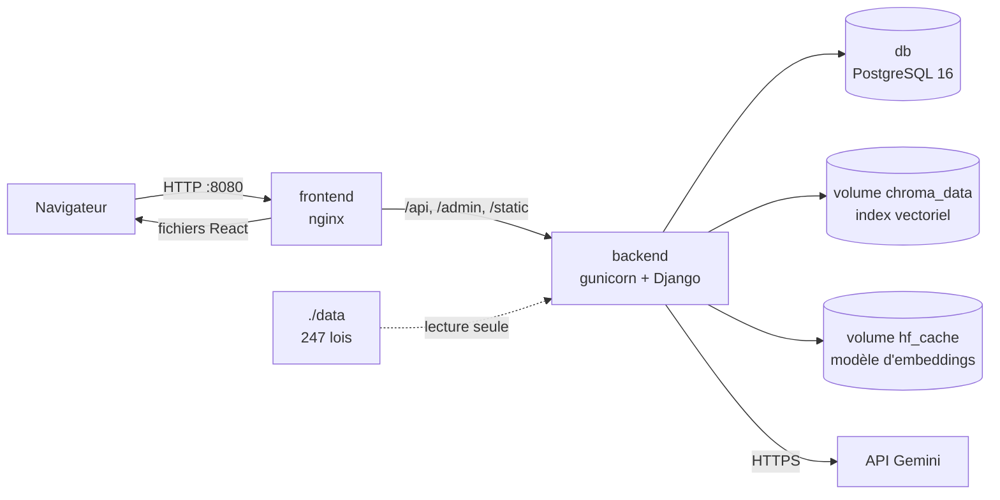

# LexIA — Guide de déploiement (Sprint 8)

Auteur : Mohamed Aouijil · Octobre 2026

## 1. Architecture déployée



| Service | Image | Rôle |
|---|---|---|
| `frontend` | nginx 1.27 + build React | Sert l'application, relaie `/api` (sans tampon pour le streaming), en-têtes de sécurité (CSP...) |
| `backend` | Python 3.12 + gunicorn | API Django, pipeline RAG ; utilisateur non-root ; 1 processus × 8 threads (le modèle n'est chargé qu'une fois) |
| `db` | PostgreSQL 16 | Comptes, conversations, lois, avis |

Volumes persistants : `postgres_data` (base), `chroma_data` (index), `hf_cache` (modèle
`multilingual-e5-base`, téléchargé au premier démarrage).

**Ressources minimales** : 2 cœurs, **4 Go de RAM** (modèle ≈ 1,1 Go + PyTorch), 10 Go de disque.

## 2. Installation

Prérequis : Docker et Docker Compose v2 (sous Windows : Docker Desktop avec WSL 2).

```bash
git clone https://github.com/mohamedaoui/LexIA.git
cd LexIA
cp .env.example .env
```

Remplir `.env` :

```ini
DJANGO_SECRET_KEY=...   # python -c "import secrets; print(secrets.token_urlsafe(50))"
POSTGRES_PASSWORD=...   # idem
GEMINI_API_KEY=...      # https://aistudio.google.com/apikey
```

Démarrer :

```bash
docker compose up -d --build
```

Au premier démarrage, le backend applique les migrations et **importe automatiquement les
lois** de `data/` (≈ 1 min). L'application est ensuite sur **http://localhost:8080**.

Créer le compte administrateur :

```bash
docker compose exec backend python manage.py createsuperuser
```

## 3. Indexation des articles (une seule fois)

Sans index, LexIA répond mais sans trouver d'articles. Deux possibilités.

**A. Indexer dans le conteneur** (≈ 2 h 30 sur un processeur sans GPU, reprend si interrompu) :

```bash
docker compose exec backend python manage.py index_articles
```

**B. Réutiliser l'index déjà calculé en local** (quelques minutes ; procédure non couverte
par la CI). Les identifiants de l'index correspondent aux clés des articles : il faut donc
copier la base juridique **et** l'index, sur une installation neuve, avant le premier
démarrage complet :

```bash
# Sur le PC de développement (dossier backend, environnement activé)
python manage.py dumpdata legal -o legal.json

# Sur le serveur
docker compose up -d db
docker compose run --rm --entrypoint "" -v ./backend/legal.json:/tmp/legal.json:ro backend \
    sh -c "python manage.py migrate && python manage.py loaddata /tmp/legal.json"
docker compose run --rm --entrypoint "" -v ./backend/chroma_db:/src:ro backend \
    sh -c "cp -r /src/. /app/chroma_db/"
docker compose up -d
```

Vérifier : `curl http://localhost:8080/api/health/` doit indiquer `"indexed_articles": 12810`.

## 4. Vérification du déploiement

```bash
bash scripts/smoke_test.sh http://localhost:8080
```

Le script contrôle, à travers nginx : la page d'accueil et les routes React, les en-têtes de
sécurité (CSP, X-Frame-Options, version masquée), la santé du service, les catégories,
l'admin Django et ses fichiers statiques, l'inscription, la connexion, les droits d'accès,
l'absence de détail technique dans les erreurs et la limite de tentatives de connexion.

**Ce même script tourne à chaque push** dans GitHub Actions (`.github/workflows/deploy.yml`) :
les images sont construites, le déploiement complet est démarré puis vérifié. C'est le
critère CR9 (« docker compose up sans erreur ») vérifié automatiquement.

## 5. Exploitation

| Besoin | Commande |
|---|---|
| Journaux | `docker compose logs -f backend` |
| État | `docker compose ps` · `curl http://localhost:8080/api/health/` |
| Mise à jour | `git pull && docker compose up -d --build` |
| Sauvegarde de la base | `docker compose exec db pg_dump -U lexia lexia > sauvegarde.sql` |
| Restauration | `docker compose exec -T db psql -U lexia lexia < sauvegarde.sql` |
| Reclasser l'historique après modification des catégories | `docker compose exec backend python manage.py load_categories && docker compose exec backend python manage.py classify_messages --all` |
| Arrêt | `docker compose down` (ajouter `-v` efface aussi les données) |

## 6. Mise en ligne publique

Le déploiement fourni sert en HTTP sur le port 8080. Pour un serveur accessible sur Internet :

1. **Hébergement** : un serveur virtuel Linux avec au moins 4 Go de RAM (les offres gratuites
   des plateformes type Render ou Railway n'ont pas assez de mémoire pour le modèle).
2. **HTTPS** : placer un proxy TLS devant le port 8080 (Caddy, Traefik ou nginx + Let's
   Encrypt), puis dans `.env` :

   ```ini
   DJANGO_ALLOWED_HOSTS=lexia.example.ma
   DJANGO_CSRF_TRUSTED_ORIGINS=https://lexia.example.ma
   DJANGO_HTTPS=True
   ```

   `DJANGO_HTTPS=True` active la redirection HTTPS, HSTS (1 an) et les cookies sécurisés.
   Le proxy TLS ajoute un intermédiaire : passer alors `DJANGO_NUM_PROXIES` à `2` dans
   `docker-compose.yml` pour que les limites de requêtes voient la vraie IP des clients.
3. **Pare-feu** : n'ouvrir que les ports 80 et 443 ; PostgreSQL n'est jamais exposé (aucun
   port publié dans `docker-compose.yml`).
4. **Quota Gemini** : l'offre gratuite limite le nombre de requêtes par jour et par modèle ;
   pour un usage réel, prévoir une clé avec facturation.
